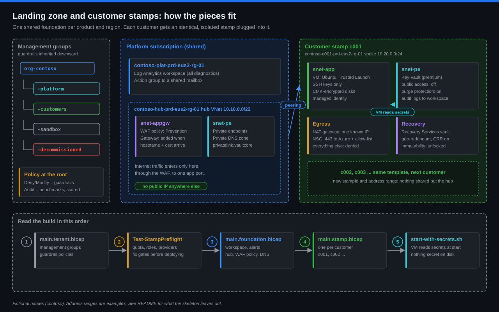
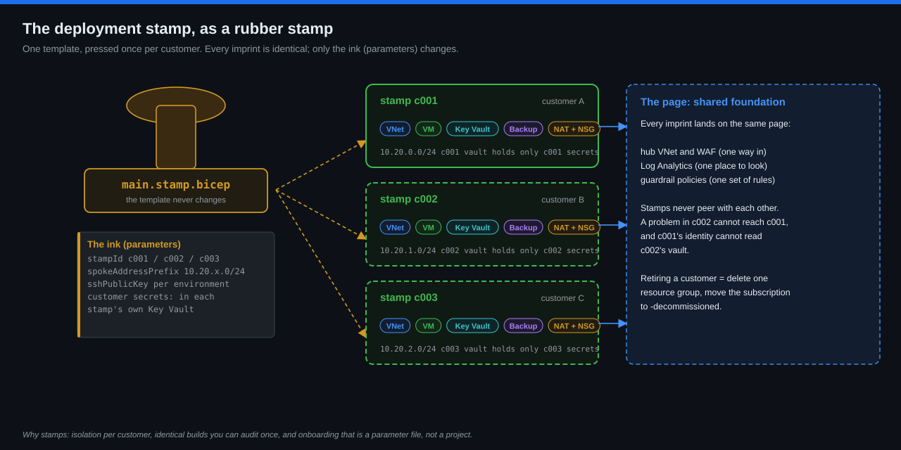
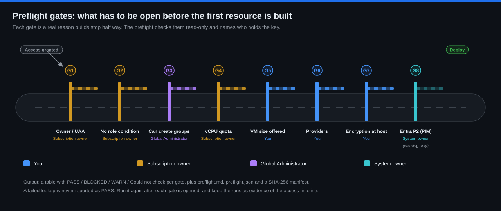
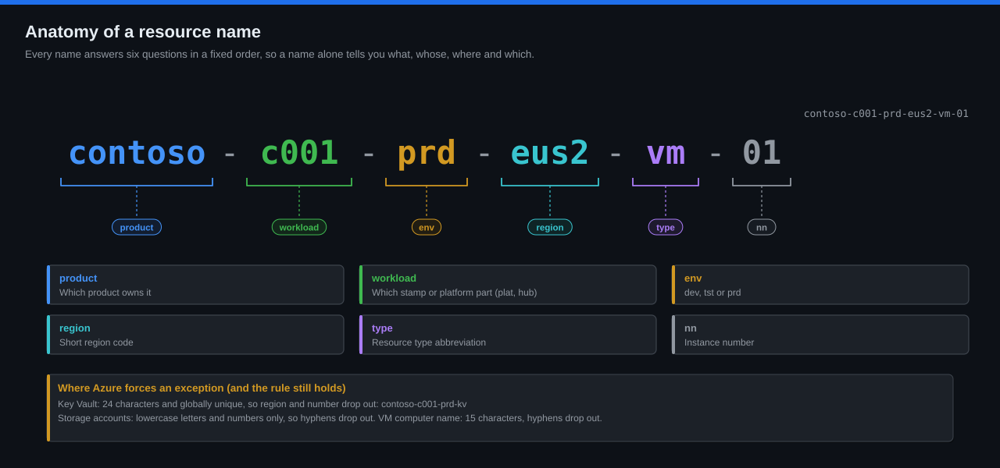
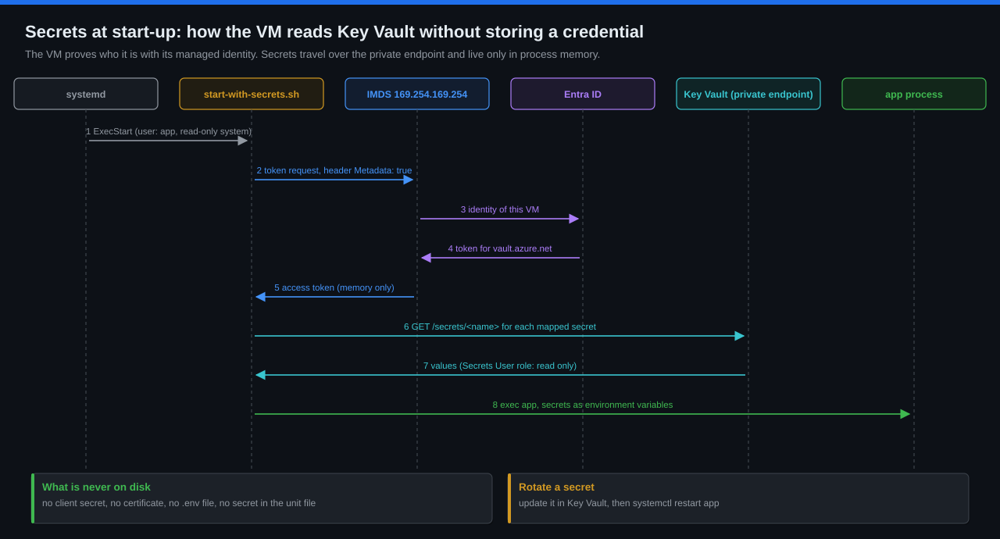

# Landing zone and customer stamps (skeleton)

A skeleton of how I build an Azure tenant for a multi-customer SaaS product: a shared foundation per product and region, and one identical, isolated **stamp** per customer plugged into it. Written as Bicep, with a read-only preflight in PowerShell and a start-up script that lets the VM read its secrets without storing a credential.

This is the **skeleton** ("the bones"): every file compiles or parses and shows the structure, naming and security decisions of a real build, with the long tail of resources left as marked `TODO`s. Names are fictional (`contoso`). No client, tenant or subscription details appear anywhere.



## The idea in one picture

A stamp is a rubber stamp: one template, pressed once per customer. Every imprint is identical. Only the parameters change (stamp ID, address range, the secrets in that stamp's own vault).



Why build this way:

- **Isolation.** Stamps never peer with each other. One customer's VM identity cannot read another customer's vault.
- **One audit, many customers.** The template is reviewed once; every stamp is the same build.
- **Onboarding is a parameter file**, and offboarding is one resource group.

## What is in this folder

```
bicep/
  main.tenant.bicep            management groups + guardrail policies (tenant scope)
  main.foundation.bicep        platform RG (Log Analytics, alerts) + hub RG (VNet, WAF policy, private DNS)
  main.stamp.bicep             one customer stamp (subscription scope)
  modules/
    guardrails.bicep           Deny/Modify guardrails, kept apart from Audit benchmarks
    monitoring.bicep           workspace + action group
    hub.bicep                  hub VNet, WAF policy (Prevention), Key Vault private DNS zone
    spoke.bicep                stamp VNet, NSG (deny by default both ways), NAT gateway, peering
    peering-hub-side.bicep     the hub half of the peering
    vault.bicep                Key Vault (RBAC, purge protection, no public access), CMK, disk encryption set, private endpoint
    vm.bicep                   Ubuntu, Trusted Launch, SSH keys only, CMK disks, read-only secrets role
    backup.bicep               Recovery Services vault (GRS, cross-region restore, immutability unlocked)
  foundation.example.bicepparam
  stamp.example.bicepparam
scripts/
  Test-StampPreflight.skeleton.ps1   read-only gate check before deploying
vm-secrets-at-start/
  app.service                  hardened systemd unit
  start-with-secrets.sh        fetches secrets with the VM identity, then execs the app
  app.conf.example             which vault, which secret maps to which variable (no secrets)
examples/
  preflight-facts.example.json fictional facts used to test the preflight offline
diagrams/                      the diagrams on this page
```

## Order of work

1. **Preflight.** `scripts/Test-StampPreflight.skeleton.ps1` (read-only).
2. **Management groups and guardrails.** `az deployment tenant create --template-file bicep/main.tenant.bicep ...`
3. **Foundation.** `az deployment sub create --template-file bicep/main.foundation.bicep --parameters bicep/foundation.example.bicepparam`
4. **First stamp.** `az deployment sub create --template-file bicep/main.stamp.bicep --parameters bicep/stamp.example.bicepparam`
5. **Install the workload** with `vm-secrets-at-start/`, then capture evidence with [azure-posture-check](https://github.com/richdieu-max/azure-posture-check).

## Preflight gates

Most builds that stop half way stop for a reason that existed before the first resource was created. The preflight checks each one read-only and says who has to act.



| Gate | Checks | Usually opened by |
|---|---|---|
| G1 | Owner or User Access Administrator on the subscription | Subscription owner |
| G2 | That role carries **no condition**. A conditioned Owner can deploy resources but not make the build's own role grants | Subscription owner |
| G3 | The account can create Entra ID security groups. Azure Owner is not a directory role, and guest accounts usually cannot | Global Administrator |
| G4 | vCPU quota for the VM family (new subscriptions often have zero) | Subscription owner (quota request) |
| G5 | The VM size is offered to this subscription in the region | You (pick a newer family) |
| G6 | Resource providers registered | You |
| G7 | `EncryptionAtHost` feature registered | You |
| G8 | Entra ID P2 for just-in-time roles. A warning: without it the build uses standing group roles and records the risk | System owner |

Try it without signing in:

```powershell
./scripts/Test-StampPreflight.skeleton.ps1 -FactsFile ./examples/preflight-facts.example.json
```

It writes `preflight.md`, `preflight.json` and a SHA-256 `MANIFEST.json`. Keep each run: together they are the evidence of when access was ready, which is when a delivery clock should start.

## Naming

Every resource name answers six questions in a fixed order.



Management groups and security groups use an organisation prefix instead (`org-contoso-platform`, `sg-az-org-contoso-platform-ops`), so they sort together in the portal.

## Network decisions worth copying

- **One way in.** Internet traffic reaches the workload only through the WAF in the hub, on one port, from the gateway subnet. No NIC has a public IP.
- **Deny by default, both directions.** The NSG ends inbound and outbound with deny rules. Outbound HTTPS is allowed to Azure services and to an explicit allow-list of vendor endpoints, not to the whole internet. "Outbound 443 to anywhere" is the most common gap I find in reviews.
- **One known egress IP.** The NAT gateway gives the stamp a single static address that vendors can allow-list.
- **WAF in Prevention from day one.** The policy is built before the gateway exists (the gateway needs a hostname and certificate, which usually arrive later), so it never runs in Detection by accident.

## Secrets at start-up

The VM's managed identity holds **Key Vault Secrets User** on its own stamp's vault: read, never write. At start, systemd runs `start-with-secrets.sh`, which gets a token from the Instance Metadata Service, reads each mapped secret through the private endpoint, exports them and `exec`s the app.



- No client secret, certificate or `.env` file exists on the VM.
- The vault has public network access disabled. Seeding secrets therefore needs an in-network path, or a short, recorded "selected networks" window. Plan it before go-live.
- Rotation is "update in Key Vault, restart the service".
- The unit file runs as a dedicated user on a read-only system (`ProtectSystem=strict`, `NoNewPrivileges`, empty capability set).

## What the skeleton leaves out

Marked `TODO` in the files: the benchmark initiative and tag-modify policies, the Application Gateway itself, linking each stamp VNet to the private DNS zone, the backup policy and VM enrolment, PIM assignments, per-service-tag outbound rules, and the Graph lookups in the preflight. The full build also adds diagnostic settings to every resource and tags resource groups for cost reporting.

## How it is checked

CI compiles every Bicep file, lints and runs the shell script, parses the PowerShell, and runs the preflight offline against the example facts. See `.github/workflows/landing-zone.yml`.

## Related

- [Azure tenant foundation runbook](../runbooks/azure-tenant-foundation.md): the day-zero steps this build assumes (break-glass accounts, MFA, domain).
- [azure-posture-check](https://github.com/richdieu-max/azure-posture-check): proves the build is still the way it was built, and holds the remediation kit.
- [security-assessment-toolkit](https://github.com/richdieu-max/security-assessment-toolkit): the registers, the log archive and the supply-chain scan.
