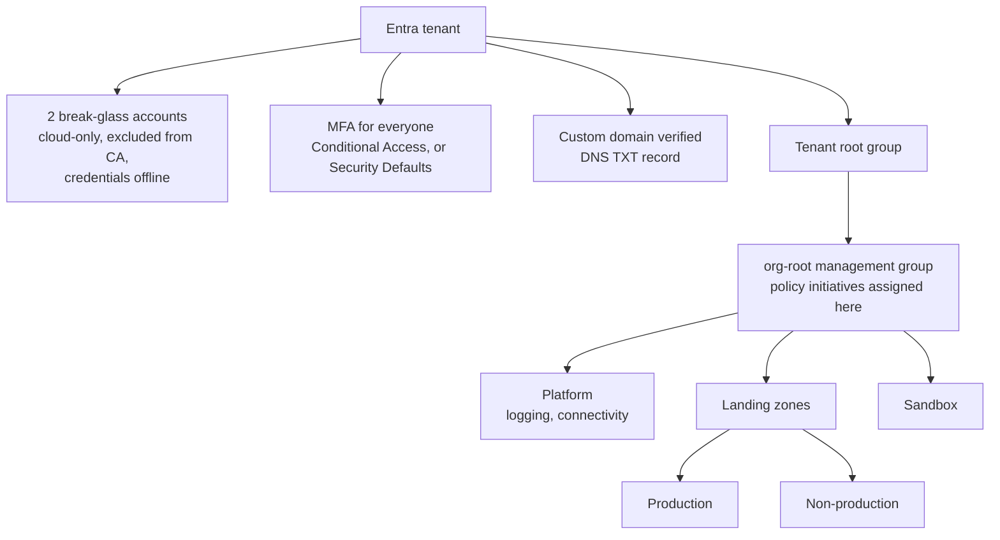

# Azure tenant foundation: day-zero identity and governance

Create a Microsoft Entra tenant and put the controls in place that have to exist **before** the first resource is deployed: emergency access, MFA, a verified domain, and a management group hierarchy carrying policy.

## Decide before you click Create

The organisation name and the initial `*.onmicrosoft.com` domain are permanent, and the country or region sets where directory data lives. Choose standard **Microsoft Entra ID**, not B2C; a B2C tenant cannot be converted. For US government workloads, build in Azure Government instead.

## Target end state

## Steps

1. **Create the tenant.** Azure portal → Microsoft Entra ID → Manage tenants → Create → Microsoft Entra ID. Enter organisation name, initial domain and country. Record the tenant ID. Use a private browser window if you are signed in to another tenant.
2. **Emergency access accounts.** Two cloud-only accounts on the `onmicrosoft.com` domain, Global Administrator, long random passwords (or FIDO2 keys), not tied to one person, excluded from every Conditional Access policy through a named exclusion group, credentials stored offline. Alert on any sign-in by these accounts.
3. **MFA.** Turn on Security Defaults for a small tenant. For anything larger, use Conditional Access: require MFA for all users, block legacy authentication, require phishing-resistant MFA for admins. Never leave a gap between turning Security Defaults off and turning CA on.
4. **Custom domain.** Entra ID → Custom domain names → Add → create the `MS=` TXT record at the registrar → Verify once DNS propagates.
5. **Management groups and policy.** Create the hierarchy above, move subscriptions under it, and assign policy at the org root: allowed locations, no public IP on NICs, required tags, plus a benchmark initiative (Microsoft cloud security benchmark or CIS) in audit mode to score against.

## Evidence this produces

| Evidence | Where |
|---|---|
| Tenant creation | Entra ID → Audit logs, activity "Create tenant" |
| Who holds Global Administrator | Entra ID → Roles and administrators → Global Administrator → Assignments |
| MFA enforcement | Entra ID → Security → Conditional Access → Policies (or Security Defaults setting) |
| Domain verification | Entra ID → Custom domain names → Status: Verified |
| Policy at the root | Management groups → org root → Policies, and the compliance view |

## Control mapping

These steps **support** the controls below; they do not satisfy a framework on their own.

| Framework | Reference | How this supports it |
|---|---|---|
| NIST SP 800-53 R5 | AC-2, IA-2, IA-2(1) | Managed accounts, unique identities, MFA |
| | CP-2 | Emergency access path documented and tested |
| | CM-2, PL-8 | Policy baseline and governance hierarchy before workloads exist |
| NIST CSF 2.0 | PR.AA-01, PR.AA-03, GV.PO-01 | Identities managed; users authenticated; policy established |
| ISO/IEC 27001:2022 | 5.15, 5.16, 5.17, 8.5 | Access control; identity management; authentication information; secure authentication |
| SOC 2 | CC6.1 | Logical access security over the cloud environment |
